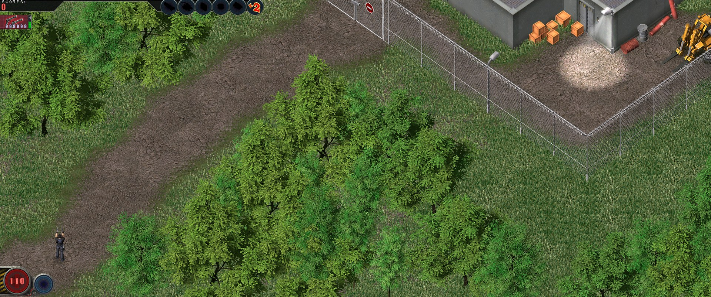
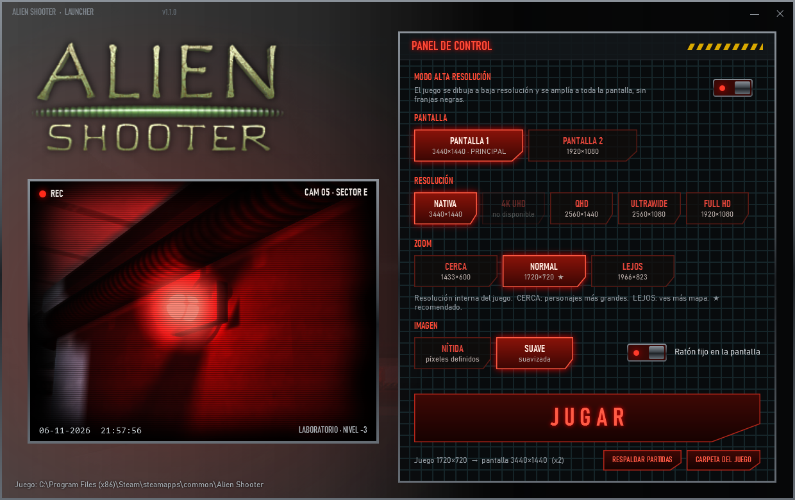
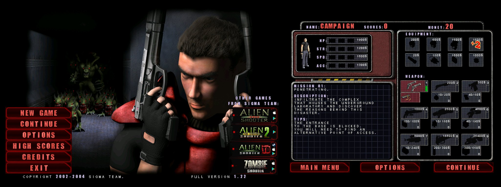
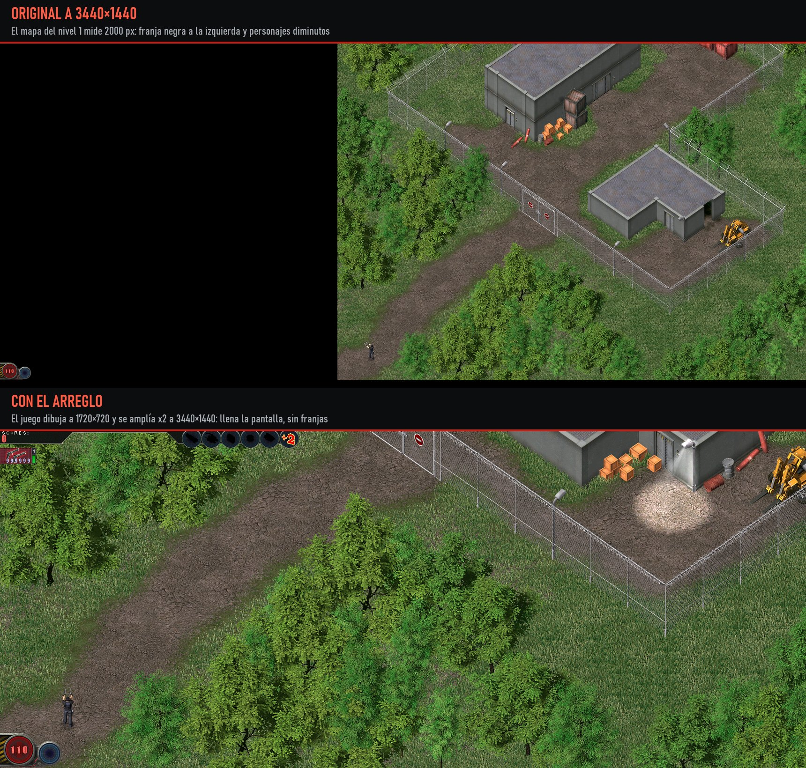
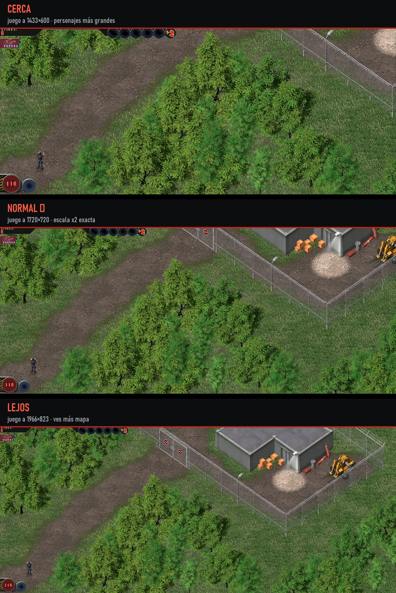

# Alien Shooter en alta resolución: panorámico, ultrawide y 4K (widescreen fix)

**Alien Shooter widescreen fix for the Steam version**: 16:9 and 21:9 ultrawide, 1440p and 4K,
no black bars, with a launcher themed after the game. Bring your own copy of the game.
[English version below](#english).



Un arreglo (*widescreen fix*) para jugar **Alien Shooter** (Sigma Team, 2003; versión de Steam) a la
**resolución de tu pantalla**: 1080p, 1440p, **ultrawide 21:9 (2560×1080, 3440×1440)** o **4K en tu
TV**. La imagen llena toda la pantalla, **sin franjas negras** y sin deformarse. Incluye un
**lanzador** con el aspecto del juego para elegir pantalla, resolución y zoom.

**Este repositorio no contiene nada del juego.** Necesitas *Alien Shooter* instalado (Steam). El
lanzador toma su aspecto (logo, fondos, sonidos y cursor) de tu propia copia del juego.

## Descarga y uso

1. Descarga **[`AlienShooterWidescreenFix-windows.zip`](https://github.com/Cris9870/alien-shooter-widescreen-fix/releases/latest/download/AlienShooterWidescreenFix-windows.zip)**
   (en [Releases](https://github.com/Cris9870/alien-shooter-widescreen-fix/releases/latest)) y
   descomprímelo en una carpeta cualquiera.
2. Abre **`Alien Shooter Launcher.exe`**. Encuentra solo el juego en tu biblioteca de Steam.
3. Deja activado **MODO ALTA RESOLUCIÓN**, elige pantalla, resolución y zoom, y pulsa **JUGAR**.

A partir de ahí también puedes abrir el juego directamente desde Steam: usa los últimos ajustes del
lanzador. No hace falta instalar nada más: el lanzador funciona con lo que ya trae Windows 10/11.

**Actualizaciones automáticas** (desde la 1.1.0): al abrirse, el lanzador comprueba si hay una versión
nueva en GitHub. Si la hay, lo avisa abajo a la izquierda; pulsa **ACTUALIZAR** y se descarga, se
comprueba y se instala sola en unos segundos, sin tocar tus ajustes ni tus partidas. Sin conexión no
hace nada. Si tienes la 1.0.0, descarga la última versión a mano una vez y cópiala encima: a partir
de ahí se actualiza sola.

> **Windows protegió su PC**: al ser un programa nuevo y sin firma digital, Windows puede avisar la
> primera vez. Pulsa **Más información → Ejecutar de todas formas**.

| Versión del juego | Estado |
|---|---|
| *Alien Shooter* de Steam ("Full version 1.22") | Probada |
| Otras ediciones (CD, otras tiendas) | **Sin verificar**; si la pruebas, cuéntalo en [Issues](https://github.com/Cris9870/alien-shooter-widescreen-fix/issues) |

| | |
|---|---|
|  |  |
| El lanzador, en español y con el aspecto del juego | Los menús del juego, ampliados x2 en un monitor 3440×1440 |

## Qué ofrece

| | Juego original | Con este arreglo |
|---|---|---|
| **Resolución** | Como máximo 1280 px de ancho (en un ultrawide se queda en 1280×720) | **La de tu pantalla**: 1080p, 1440p, ultrawide 2560×1080 o 3440×1440, **4K** |
| **Franja negra** | Si se fuerza más resolución, los niveles 1 y 11 (2000 px de ancho) dejan una franja negra y la cámara no se mueve | **Nunca**: el juego dibuja a 2000 px de ancho o menos y se amplía a la pantalla |
| **Tamaño de la imagen** | A resolución nativa todo se ve diminuto | **Zoom** a elegir: *Normal* (x2 exacto), *Cerca* (personajes más grandes) o *Lejos* (más mapa) |
| **Ultrawide 21:9** | No | **Sí**, sin estirar la imagen |
| **TV 4K** | No | Elige la TV en el lanzador: el juego dibuja a 1920×1080 y se muestra x2 a 3840×2160 |
| **Pantalla completa** | Cambia la resolución del monitor | **Ventana sin bordes** a pantalla completa (Alt+Tab al instante), o la resolución que elijas |
| **Varias pantallas** | Siempre la principal | Eliges en qué pantalla se abre (monitor, segundo monitor, TV) |
| **Ratón** | — | Apunta donde debe y no se escapa a otra pantalla mientras juegas |
| **Imagen** | — | *Nítida* (píxeles definidos) o *Suave* (suavizada) |
| **El juego** | — | El `.exe` original **no se modifica**; se desactiva con un clic |
| **Actualizaciones** | — | El lanzador avisa de las versiones nuevas y se actualiza solo con un botón |

## Capturas



Arriba, el juego forzado a la resolución nativa de un monitor ultrawide (3440×1440): el mapa del
nivel 1 mide solo 2000 px de ancho, así que sobra una franja negra y todo se ve diminuto. Abajo, con
el arreglo: el juego dibuja a 1720×720 y se amplía x2 hasta llenar la pantalla.



Los tres niveles de zoom del lanzador en el mismo punto del nivel 1, a 3440×1440.

## Preguntas frecuentes

- **¿Mejora los gráficos?** No los redibuja: el arte del juego es de 2003. Lo que cambia es que la
  imagen llena tu pantalla con la proporción correcta, sin franjas y bien escalada (x2 exacto con el
  zoom *Normal*).
- **¿4K aparece como "no disponible"?** Solo aparece disponible si la pantalla elegida tiene ese
  modo. Elige tu TV 4K en *Pantalla*, o activa DSR (NVIDIA) o VSR (AMD) para usarla en un monitor
  de menor resolución.
- **¿Cómo actualizo?** El lanzador te avisa cuando hay una versión nueva: pulsa **ACTUALIZAR**. La
  descarga se verifica con la huella SHA-256 que publica GitHub antes de instalar nada; si algo
  falla, tu versión actual queda intacta. También puedes descargar el zip y copiarlo encima. Si
  tienes el lanzador en *Archivos de programa*, muévelo a otra carpeta para que pueda actualizarse.
- **¿Cómo lo quito?** Desactiva *MODO ALTA RESOLUCIÓN* en el lanzador (borra la DLL de la carpeta
  del juego) o borra a mano `d3d9.dll` y `d3d9_upscale.ini` de la carpeta del juego.
- **¿Toca mis partidas?** No. El botón *RESPALDAR PARTIDAS* copia la carpeta `saves` del juego a
  `respaldos\`, junto al lanzador.
- **¿Y si Steam verifica los archivos del juego?** La DLL es un archivo añadido y normalmente se
  queda. Si desaparece, abre el lanzador y pulsa *JUGAR*: la vuelve a poner.
- **¿Puedo instalarlo sin el lanzador?** Sí: copia `d3d9.dll` y `d3d9_upscale.ini` de la carpeta
  `instalacion-manual` a la carpeta del juego y ajusta el `.ini` (está comentado).
- **Mi antivirus avisa de la DLL**: es un *proxy* de `d3d9.dll`, una técnica habitual en arreglos de
  pantalla que a veces se marca por heurística. El código fuente completo está en este repositorio.
- **Algo no funciona**: abre una [incidencia](https://github.com/Cris9870/alien-shooter-widescreen-fix/issues)
  con tu versión del juego, tu resolución y el archivo `d3d9_upscale.log` de la carpeta del juego.

Requisitos: **Windows 10 u 11** y *Alien Shooter* (Steam). El lanzador usa .NET Framework 4.8, que ya
viene con Windows.

## Cómo está hecho

El arreglo es una **DLL proxy de Direct3D 9** (`upscaler/upscale.c`, en C) que se coloca junto al
juego y carga la `d3d9.dll` real de Windows. Al arrancar:

- **Quita el límite de 1280 px** del juego: parchea en memoria la función que elige el modo de vídeo
  para que use la resolución que indiques. El `.exe` en disco queda intacto.
- **Escala la imagen**: el juego dibuja en una superficie de su tamaño (por ejemplo 1720×720) en lugar
  del *back buffer* real, y en cada fotograma esa superficie se amplía a la pantalla completa.
- **Envuelve el dispositivo Direct3D** con un objeto propio, porque el overlay de Steam reescribe la
  tabla de funciones del dispositivo poco después de crearlo.
- **Corrige el ratón**: el juego sigue el cursor con `WM_NCHITTEST`, en coordenadas de pantalla; la
  DLL las traduce a las coordenadas del juego, en cualquier monitor.

El **lanzador** (`launcher/`, WPF) escribe los ajustes, instala o quita la DLL (va incluida dentro del
lanzador) y abre el juego desde Steam. Su **actualizador** (`launcher/Updater.cs`) consulta la última
release de GitHub, descarga el zip, comprueba su SHA-256, lo descomprime aparte y solo entonces
reemplaza el lanzador (y la DLL del juego, si estaba instalada). Notas técnicas detalladas (en inglés):
[docs/TECHNICAL.md](docs/TECHNICAL.md).

### Compilar desde el código

Requisitos: Visual Studio 2022 o posterior con el componente de C++ (x86) y el SDK de .NET 8 o
posterior.

```bat
git clone https://github.com/Cris9870/alien-shooter-widescreen-fix
cd alien-shooter-widescreen-fix
powershell -ExecutionPolicy Bypass -File tools\package.ps1
```

Compila `upscaler\d3d9.dll` y el lanzador, y crea `dist\AlienShooterWidescreenFix-windows.zip`.
Para compilar por partes: `upscaler\build.bat` y luego
`dotnet build launcher -c Release` (el lanzador incluye la DLL, así que compílala antes).

## Legal

- Necesitas tu propia copia del juego. Ni este repositorio ni la descarga incluyen nada de *Alien
  Shooter*: el lanzador lee los gráficos, sonidos y cursor de tu instalación. Las capturas de esta
  página son solo ilustrativas.
- Proyecto de aficionados, sin relación con Sigma Team. *Alien Shooter* es © Sigma Team.
- El código está bajo **PolyForm Noncommercial 1.0.0** (`LICENSE`): uso y redistribución permitidos
  sin fines comerciales.

---

<a id="english"></a>

## English: Alien Shooter widescreen fix (ultrawide, 4K)

A widescreen and high-resolution fix for **Alien Shooter** (Sigma Team, 2003), Steam version. Play at
your display's resolution, **1080p, 1440p, 21:9 ultrawide (2560×1080, 3440×1440) or 4K on a TV**,
filling the screen with **no black bars and no stretching**. **Bring your own copy**: nothing from the
game ships here; the launcher reads the game's art, sounds and cursor from your installation.

**How to use:** download
[`AlienShooterWidescreenFix-windows.zip`](https://github.com/Cris9870/alien-shooter-widescreen-fix/releases/latest/download/AlienShooterWidescreenFix-windows.zip),
unzip it, run `Alien Shooter Launcher.exe`, pick a screen, resolution and zoom, and press **JUGAR**
("play"). It finds the game in your Steam library. After that, launching from Steam uses the same
settings. The launcher is in Spanish. **Updates** (from 1.1.0): the launcher checks GitHub Releases
on start and updates itself with one click (ACTUALIZAR); the download is checked against GitHub's
SHA-256 before anything is replaced, and your settings and saves are untouched.

| | Original game | With this fix |
|---|---|---|
| **Resolution** | Capped at 1280 px wide (1280×720 on an ultrawide) | **Your display's**: 1080p, 1440p, 2560×1080, 3440×1440, **4K** |
| **Black bars** | Forcing a higher resolution leaves a black strip: levels 1 and 11 are only 2000 px wide | **None**: the game renders at ≤2000 px wide and is scaled up |
| **Zoom** | Everything tiny at native resolution | *Normal* (exact 2×), *Cerca* (closer) or *Lejos* (see more of the map) |
| **4K TV** | No | Pick the TV in the launcher: 1920×1080 shown at exactly 2× (3840×2160) |
| **Display mode** | Exclusive fullscreen | **Borderless fullscreen** (instant Alt+Tab) or any resolution you choose, on any monitor |
| **Mouse** | — | Accurate aiming at any scale; stays on the game's screen |
| **Game files** | — | `AlienShooter.exe` is **not modified**; one click turns the fix off |

**How it works:** a Direct3D 9 proxy DLL removes the game's 1280-pixel resolution cap in memory, lets
the game render to an offscreen surface at a small resolution and scales it to the screen every frame,
wraps the D3D device (the Steam overlay rewrites the real device's vtable), and remaps the mouse,
which the game tracks through `WM_NCHITTEST`. Details: [docs/TECHNICAL.md](docs/TECHNICAL.md).

Requirements: Windows 10 or 11 and Alien Shooter (Steam). The Steam release is tested; other editions
are unverified, so reports are welcome in [Issues](https://github.com/Cris9870/alien-shooter-widescreen-fix/issues).
Non-commercial license (PolyForm Noncommercial 1.0.0). Fan project, not affiliated with Sigma Team.
